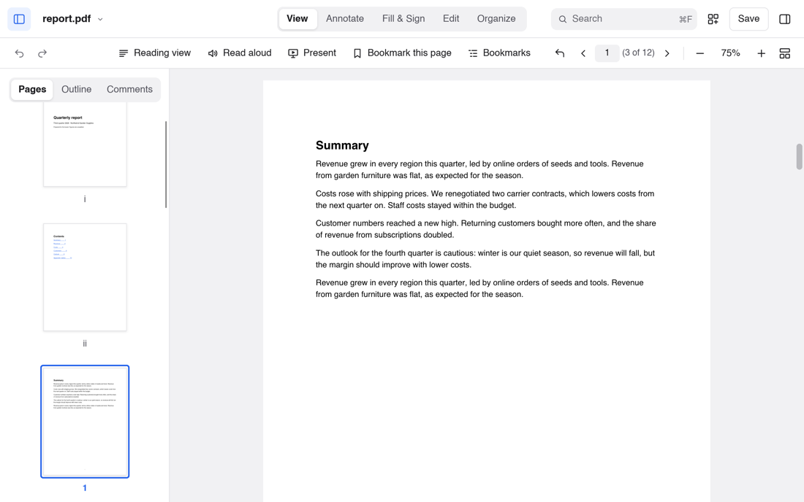
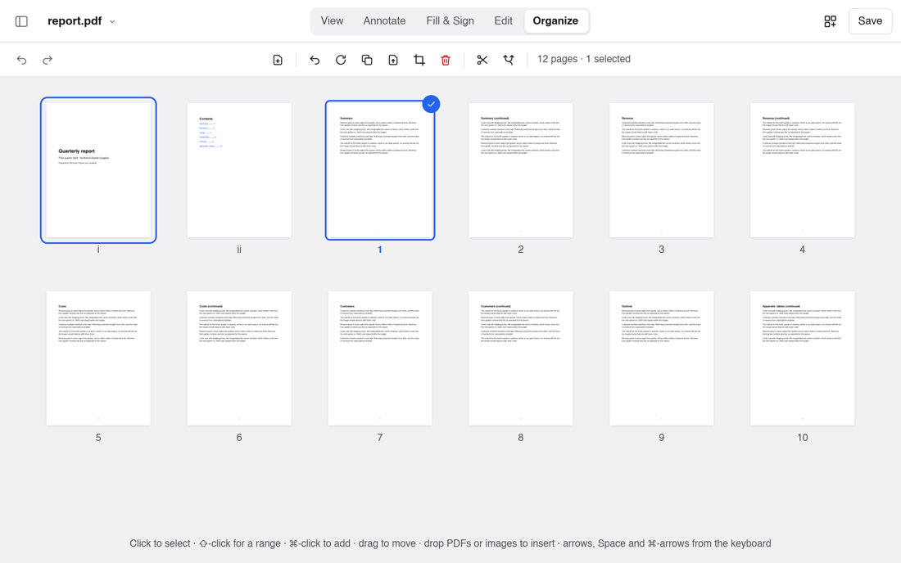
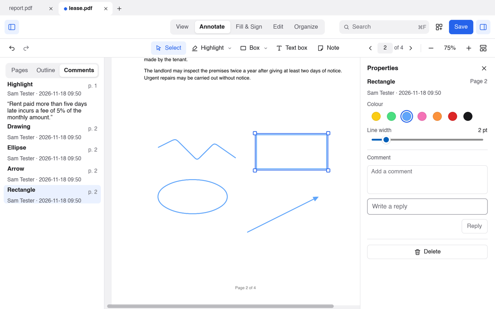
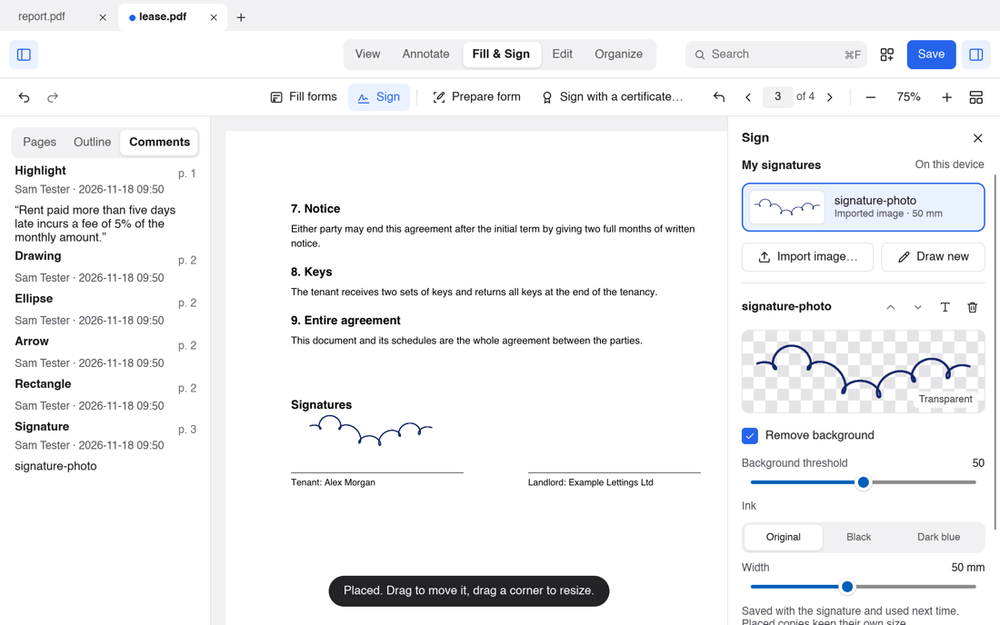
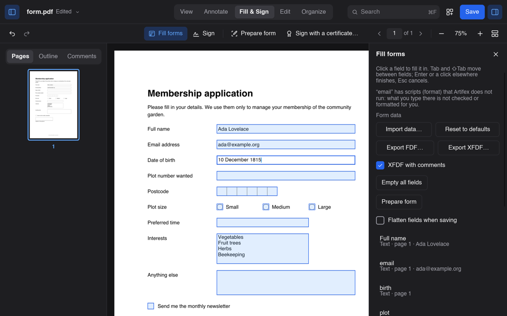
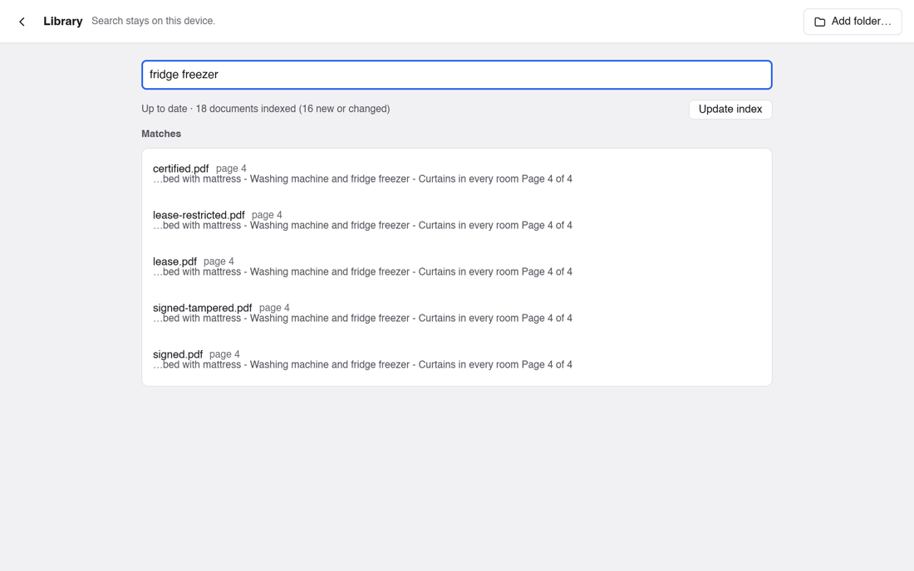

<div align="center">

<a href="https://amazynk.com/pagebara/"></a>

<h1>Pagebara</h1>

<p>
  A fast, private PDF viewer and editor with its own engine, written in safe Rust.
  <br>
  Free and open source, for Linux, Windows and macOS. No account, no cloud, no telemetry.
</p>

<p>
  <a href="https://amazynk.com/pagebara/">Website</a>
  ·
  <a href="#features">Features</a>
  ·
  <a href="#install">Install</a>
  ·
  <a href="#build-from-source">Build</a>
  ·
  <a href="#privacy">Privacy</a>
  ·
  <a href="CONTRIBUTING.md">Contributing</a>
</p>

<p>
  <a href="https://github.com/amazynk/pagebara/actions/workflows/ci.yml"></a>
  <a href="#licence"></a>
  <a href="#install"></a>
  <a href="https://amazynk.com/discord/"></a>
</p>

</div>

<p align="center">
  <a href="https://amazynk.com/pagebara/"></a>
</p>

Read, search, annotate, fill in, sign, redact and reorganise PDF files. Your documents stay
on your device. The website, [amazynk.com/pagebara](https://amazynk.com/pagebara/), shows the
app and has a small demo that runs in the browser.

## Features

- **Reading**: rendering from our own engine (parser, fonts, colour management,
  transparency, JPEG / JPEG 2000 / JBIG2 / CCITT images), tabs, thumbnails, outline,
  links with back and forward, single-page, continuous and two-page layouts, page colours
  including dark pages, a reflowing reading view, presenting, and bookmarks.
- **Search**: the desktop Find panel lists each match with its page number and a line of text.
  Limit results to matching capitalization or whole words, then click a match or browse
  with the keyboard. Select and copy page text, or search a whole folder of PDFs from the library.
- **Annotate**: highlight, underline and strike out text; draw with a pen; add shapes,
  arrows, text boxes and sticky notes with replies; move, resize, recolour and delete them.
- **Forms**: fill in every kind of field in place, reset the form, and flatten it on save.
- **Sign**: a signature library with background removal for photographed signatures, or
  signatures drawn by hand, placed and resized on the page. Digital signatures (PAdES /
  CMS) with timestamps and long-term validation, verification of signed documents, and
  digital IDs made in the app.
- **Organise pages**: rotate, duplicate, delete, reorder by dragging, insert PDFs and
  images, extract, split, combine, crop and label pages.
- **Redact**: find and mark text such as e-mail addresses, mark areas, then remove the
  content for good and verify that it is gone.
- **Text recognition (OCR)**: makes scanned pages searchable with an invisible text layer.
  The models are downloaded on request.
- **Security**: open password-protected files, and add or remove passwords and permissions.
- **Print**: a print dialog with a preview, page ranges, copies, two-sided and greyscale
  printing, or save a print-ready PDF.
- **Accessibility**: screen reader names and page text in tagged reading order, read
  aloud, full keyboard use, high contrast and larger text.
- **Undo and redo** for every edit, and incremental saves.
- **Vim keys** (Settings > Editing, off by default): `hjkl`, counts, `gg`/`G`, `/` and `n`,
  marks, `gt`, visual mode with `y` to copy, and a `:` command line (`:42`, `:w`, `:q`).
  Type `:help` for the Vim shortcuts.

| | |
|---|---|
|  |  |
|  |  |
|  | |

The screenshots show generated sample documents (`pagebara --make-samples DIR`).

## Install

Release builds are attached to each
[GitHub release](https://github.com/amazynk/pagebara/releases): an AppImage and a .deb for
Linux (x86-64, glibc 2.35 or newer), an MSI for Windows (x64) and a DMG for macOS (universal;
macOS 11 or newer). The x86-64 builds need a CPU from 2013 or later (x86-64-v3: AVX2).

## Build from source

The workspace pins a nightly toolchain in [`rust-toolchain.toml`](rust-toolchain.toml).
[rustup](https://rustup.rs) installs it on the first `cargo` command.

```sh
cargo build --release -p pagebara-app   # the binary is target/release/pagebara
cargo run --release -p pagebara-app -- some.pdf
```

**Linux.** You need a C toolchain, `pkg-config` and the fontconfig, xkbcommon and wayland
headers. On Debian or Ubuntu:

```sh
sudo apt install build-essential pkg-config libfontconfig1-dev libxkbcommon-dev libwayland-dev
```

At run time the app needs OpenGL (Mesa or a vendor driver) and either Wayland or X11.
Printing uses CUPS (`lp`), and read aloud uses Speech Dispatcher (or eSpeak NG without it).

A `cargo build` binary needs the build machine's glibc or newer. The release binary is
built for glibc 2.35 from any machine with
[cargo-zigbuild](https://github.com/rust-cross/cargo-zigbuild):
`packaging/linux/build-release.sh OUT` builds, checks and packages it (the release workflow
gets the same by building on Ubuntu 22.04).

**Windows.** Install the Visual Studio Build Tools (MSVC, C++ workload). The build links
the C runtime statically, and the exe carries its icon and version information.

**macOS.** Install the Xcode command line tools (`xcode-select --install`). For a universal
binary, add both targets and combine the builds with `lipo` (see
[`.github/workflows/release.yml`](.github/workflows/release.yml)).

**Packages.** [`packaging/`](packaging) holds the scripts that the release workflow runs:

| Script | Output |
|---|---|
| `packaging/linux/build-appimage.sh BIN OUT` | AppImage (needs `appimagetool`) |
| `packaging/linux/build-deb.sh BIN OUT` | .deb (needs `dpkg-deb`, `dpkg-shlibdeps`) |
| `packaging/linux/build-flatpak.sh BIN OUT` | Flatpak bundle (needs `flatpak-builder`) |
| `packaging/linux/build-release.sh OUT` | glibc 2.35 binary, .deb and AppImage (needs `cargo-zigbuild`) |
| `packaging/linux/check-glibc.sh BIN [2.35]` | fails if BIN needs a newer glibc |
| `packaging/windows/build-msi.sh EXE OUT` | MSI (WiX v4+, in Git Bash) |
| `packaging/macos/build-dmg.sh BIN OUT` | .app bundle and DMG |
| `packaging/third-party.py` | THIRD-PARTY-LICENSES.md |
| `packaging/icons/render.sh` | the desktop icons, Android adaptive and themed icons and iOS app icon from `app.svg` |

## Crates

| Crate | What it does |
|---|---|
| [`apps/desktop`](apps/desktop) (`pagebara-app`) | The desktop app: a Slint window around `pagebara-app-core` |
| [`apps/mobile`](apps/mobile) (`pagebara-mobile`) | The phone and tablet app for Android and iOS, on the same `pagebara-app-core`. The release workflow does not package it yet |
| [`app-core`](crates/app-core) | UI-agnostic app logic: documents, sessions, undo, view geometry, tiles, settings |
| [`syntax`](crates/syntax) | PDF file structure: lexer, objects, cross-reference, repair, encryption, saving |
| [`filters`](crates/filters) | Stream filters and predictors |
| [`pages`](crates/pages) | Page tree and page operations: insert, delete, move, rotate, split, merge, crop |
| [`content`](crates/content) | Content streams: interpreter, display lists, text extraction and layout |
| [`font`](crates/font) | Font programs (TrueType, OpenType, CFF, Type 1): outlines, fallback, subsetting |
| [`render`](crates/render) | Page renderer: rasteriser, colour management, transparency, images, shadings, text |
| [`annot`](crates/annot) | Annotations: typed model, editing with generated appearances, image stamps |
| [`forms`](crates/forms) | Interactive forms: filling, appearances, flattening, FDF/XFDF/JSON |
| [`signatures`](crates/signatures) | Signature images: import with background removal, drawing, library, placement |
| [`sign`](crates/sign) | Digital signatures: PAdES/CMS verify and sign, RFC 3161 timestamps, LTV |
| [`redact`](crates/redact) | True redaction: marking, content removal, sanitising, verification |
| [`ocr`](crates/ocr) | Text recognition (PP-OCRv5 on RTen) and an invisible, searchable text layer |
| [`tagged`](crates/tagged) | Tagged PDF: structure tree and reading order |
| [`codec/flate`](crates/codec/flate) | DEFLATE / zlib decompression |
| [`codec/ccitt`](crates/codec/ccitt) | CCITT Group 3 / Group 4 fax decoding |
| [`codec/jpeg`](crates/codec/jpeg) | JPEG decoder: baseline, progressive, arithmetic, lossless; scaled and region decode |
| [`codec/jp2`](crates/codec/jp2) | JPEG 2000 and HTJ2K decoder |
| [`codec/jbig2`](crates/codec/jbig2) | JBIG2 decoder |
| [`codec/png`](crates/codec/png) | PNG / APNG decoder and a small encoder |
| [`support/budget`](crates/support/budget) | Shared memory budget for large decoder allocations |
| [`support/thread`](crates/support/thread) | Named threads and rayon pools |
| [`support/identity`](crates/support/identity) | The app's name, ID and per-user directories, in one place |
| [`os`](crates/os) | Desktop integration: one running instance, `file://` and `#page=N` arguments, the system's recent files, default-app registration |
| [`integration`](crates/integration) | Optional system integration, item by item (Settings > System > System integration, `--integration`): what each registers, its status, and undoing exactly that |
| [`native`](crates/native) | The few native calls integration needs (macOS open-documents event, Dock menu, recent items, default app; Windows recent documents, jump list, taskbar progress), each in a small module allowed to use `unsafe` |
| [`shell-win`](crates/shell-win) | Windows Explorer thumbnails, preview pane and Windows Search text, as a COM DLL drawn with our own engine |
| [`actions`](crates/actions) | File actions without a window (`--action`): merge, split, rotate, compress, pages to images, images to PDF, OCR, filling a form from FDF/XFDF |
| [`update`](crates/update) | Opt-in update checks: an Ed25519-signed manifest, verified downloads, installing them |

[`fuzz/`](fuzz) holds the cargo-fuzz targets for the parser and the decoders.

## Tests

```sh
cargo test --workspace                                # unit and integration tests
cargo clippy --workspace --all-targets -- -D warnings
cargo fmt --all --check
```

The end-to-end suite runs UI scripts (`apps/desktop/tests/e2e/*.pdfs`) against the real
window on a virtual X display, so it needs `Xvfb` (`xvfb-run`). The first argument is an
output folder, which the script wipes and then fills with logs and screenshots:

```sh
cargo build -p pagebara-app
apps/desktop/tests/e2e/run.sh /tmp/pagebara-e2e                 # every script
apps/desktop/tests/e2e/run.sh /tmp/pagebara-e2e apps/desktop/tests/e2e/03-annotate.pdfs
PAGEBARA=target/release/pagebara apps/desktop/tests/e2e/run.sh /tmp/pagebara-e2e   # another binary
```

The OCR script runs only when `PAGEBARA_OCR_MODELS` names a folder that holds the models (see
the e2e job in [`.github/workflows/ci.yml`](.github/workflows/ci.yml) for the files and their
SHA-256 values). The tests never download anything.

Fuzzing: `cd fuzz && ./seed.sh && SECS=60 ./run.sh` (needs `cargo install cargo-fuzz`).

## Privacy

Pagebara is local-first. Documents, settings, signatures and the library index stay on your
device, and there is no telemetry or crash reporting. The app uses the network only when
you ask for something that needs it:

- downloading the text recognition models, the first time you run OCR;
- asking a timestamp server for a timestamp when you sign with one;
- fetching revocation data (OCSP / CRL) when you check or sign with long-term validation;
- opening a web link, which goes to your browser after you confirm it;
- checking for updates, only in builds that publish them (an address and key in
  `crates/support/identity`) and only after you turn it on in Settings or press
  "Check now". The update information must carry the release key's signature, and a
  download is used only when its SHA-256 matches.

Opened files are added to the system's recent files (the desktop's `recently-used.xbel`
on Linux, recent documents on Windows, Open Recent on macOS) like other apps do; Settings
> System integration turns that off, and everything else the app can register with the
system — thumbnails, the preview pane, search, file-manager menus, Send To, the default
app — is off until you turn it on there, one item at a time. "Remove all system
integration" (or `pagebara --integration remove-all`) undoes exactly what was registered.
Installers register only the launcher entry and "Open with".

On macOS, choose **Pagebara → Settings…** (⌘,) for preferences or **Pagebara → Finder Quick
Actions…** to enable individual actions. In Finder, Control-click the selected PDFs or
images and choose **Quick Actions**. For example, select PDFs to merge them or select
PNG and JPEG images to convert them to PDF.

A build without the default `network` feature
(`cargo build -p pagebara-app --no-default-features`) has no network code at all.

## Community

Questions and ideas are welcome on [Discord](https://amazynk.com/discord/), and bug reports
in the [issue tracker](https://github.com/amazynk/pagebara/issues). See
[CONTRIBUTING.md](CONTRIBUTING.md), the [code of conduct](CODE_OF_CONDUCT.md) and, for
security issues, [SECURITY.md](SECURITY.md). Pagebara is one of the tools at
[amazynk.com](https://amazynk.com/).

## Licence

Licensed under either of

- Apache License, Version 2.0 ([LICENSE-APACHE](LICENSE-APACHE))
- MIT License ([LICENSE-MIT](LICENSE-MIT))

at your option. Unless you explicitly state otherwise, any contribution that you
intentionally submit for inclusion in the work, as defined in the Apache-2.0 licence, is
dual licensed as above, without any additional terms or conditions.

The user interface uses [Slint](https://slint.dev) under its Royalty-free License. See
[THIRD-PARTY.md](THIRD-PARTY.md) for that and for the other third-party notices (the Inter
font, the OCR models, Adobe CMaps).
